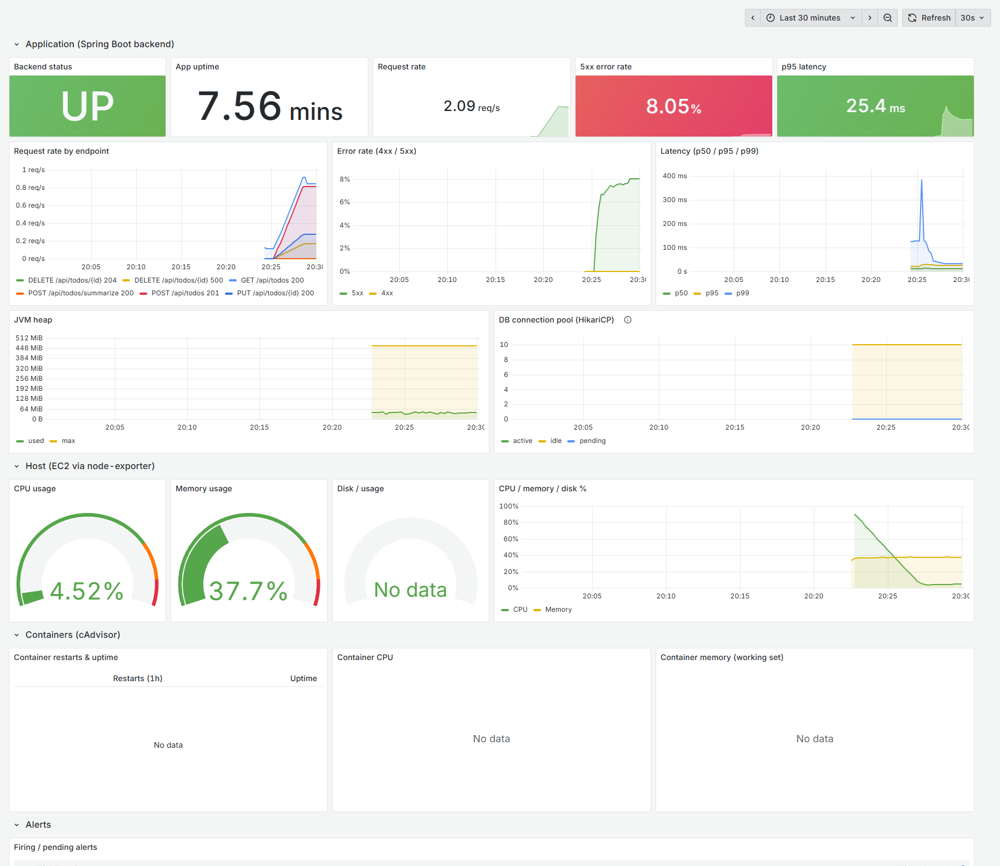

# Todo Summary Assistant

A full-stack application to manage personal to-do items, summarize pending tasks using Cohere LLM, and send the summary to a Slack channel.

This fork adds a production-style delivery pipeline: Docker images, GitHub Actions CI/CD, deployment to AWS EC2 with RDS MySQL, and Prometheus/Grafana monitoring.

| Deliverable | Location |
|---|---|
| Dockerfiles (multi-stage, non-root) | [`Backend/todo-summary-assistant/Dockerfile`](Backend/todo-summary-assistant/Dockerfile), [`Frontend/todo/Dockerfile`](Frontend/todo/Dockerfile) and their `.dockerignore` files |
| Compose (app + monitoring) | [`docker-compose.yml`](docker-compose.yml), plus [`docker-compose.local.yml`](docker-compose.local.yml) (adds local MySQL) |
| CI/CD pipeline | [`.github/workflows/ci-cd.yml`](.github/workflows/ci-cd.yml), [`scripts/deploy.sh`](scripts/deploy.sh) |
| AWS architecture, setup and IaC | [`aws/architecture-diagram.png`](aws/architecture-diagram.png), [`aws/aws-setup.md`](aws/aws-setup.md), [`aws/iac/terraform/`](aws/iac/terraform) |
| Monitoring | [`monitoring/`](monitoring): `prometheus.yml`, `alert-rules.yml`, `alertmanager.yml`, `grafana-dashboard.json`, [screenshot](monitoring/grafana-dashboard-screenshot.png) |
| Environment variables | [`.env.example`](.env.example) |
| Failure and rollback | [`FAILURE_AND_ROLLBACK.md`](FAILURE_AND_ROLLBACK.md) |
| Monitoring and operations | [`MONITORING_AND_OPERATIONS.md`](MONITORING_AND_OPERATIONS.md) |

## Table of Contents

* [Features](#features)
* [Tech Stack](#tech-stack)
* [Runtime Requirements and Environment Variables](#runtime-requirements-and-environment-variables)
* [Running Locally](#running-locally)
* [Docker Design](#docker-design)
* [CI/CD Pipeline](#cicd-pipeline)
* [AWS Deployment](#aws-deployment)
* [Monitoring](#monitoring)
* [Changes Made to the Application (DevOps Enablement)](#changes-made-to-the-application-devops-enablement)
* [Assumptions](#assumptions)
* [LLM (Cohere) Setup](#llm-cohere-setup)
* [Slack Integration Setup](#slack-integration-setup)
* [Design/Architecture Decisions](#designarchitecture-decisions)

## Features

* **Create, Edit, Delete To-Do Items:** Full CRUD operations for personal to-do items.
* **View To-Do List:** Display current to-do items with their status.
* **Summarize Pending To-Dos:** Utilizes Cohere LLM to generate a concise summary of all pending to-do items.
* **Send Summary to Slack:** Automatically posts the generated summary to a configured Slack channel using Incoming Webhooks.
* **Notifications:** Provides success/failure messages for Slack operations.

## Tech Stack

* **Frontend:** React 19 (Create React App), Axios, served by nginx in production
* **Backend:** Spring Boot 3.4 (Java 17), Maven, Spring Data JPA, Actuator + Micrometer
* **Database:** MySQL 8 (AWS RDS in production)
* **LLM:** Cohere API
* **Messaging:** Slack Incoming Webhooks
* **DevOps:** Docker, Docker Compose, GitHub Actions, Docker Hub, AWS (EC2, RDS, SSM, IAM), Terraform, Prometheus, Alertmanager, Grafana, node-exporter, cAdvisor

## Runtime Requirements and Environment Variables

| Component | Requirement |
|---|---|
| Backend | JDK 17, Maven 3.9 (or the Docker image), a reachable MySQL 8 database |
| Frontend | Node.js 20+ for development. The Docker build uses Node 24, because the npm 10 bundled with Node 20/22 crashes on this lockfile with "Exit handler never called". |
| Containers | Docker 24+ with Compose v2.23+ (needed for `secrets.environment`) |

All configuration comes from environment variables. Real values are never committed: [`.env.example`](.env.example) lists every variable, and `.env` is git-ignored.

| Variable | Used by | Required | Default / example |
|---|---|---|---|
| `SPRING_DATASOURCE_URL` | backend | yes | `jdbc:mysql://localhost:3306/todo_db?createDatabaseIfNotExist=true` |
| `SPRING_DATASOURCE_USERNAME` | backend | yes | `root` |
| `SPRING_DATASOURCE_PASSWORD` | backend | yes | *(empty)* |
| `COHERE_API_KEY` | backend (`/summarize`) | for summaries | *(empty)* |
| `SLACK_WEBHOOK_URL` | backend (`/summarize`) | for summaries | *(empty)* |
| `SERVER_PORT` | backend | no | `8080` |
| `SPRING_JPA_SHOW_SQL` | backend | no | `false` |
| `JAVA_OPTS` | backend container | no | `-XX:MaxRAMPercentage=75 -XX:+ExitOnOutOfMemoryError` |
| `REACT_APP_API_BASE_URL` | frontend (**build time**) | no | `http://localhost:8080/api` (dev), `/api` (Docker image) |
| `BACKEND_URL` | frontend nginx container | no | `http://backend:8080` |
| `IMAGE_REPO`, `IMAGE_TAG` | compose | no | `local`, `latest` (CI deploys `<dockerhub user>` and the commit SHA) |
| `APP_PORT` | compose | no | `80` |
| `GRAFANA_ADMIN_PASSWORD` | grafana | yes (compose) | — |
| `ALERT_SLACK_WEBHOOK_URL` | alertmanager | for alert delivery | *(empty, so alerts are visible in Prometheus and Grafana only)* |

## Running Locally

### Option A: everything in Docker (recommended)

Prerequisites: Docker Desktop.

```bash
git clone https://github.com/iam-bhoomi/todo-summary-assistant-devops.git && cd todo-summary-assistant-devops
cp .env.example .env            # defaults work locally; add Cohere/Slack values to use /summarize
docker compose -f docker-compose.yml -f docker-compose.local.yml up -d --build
```

| URL | What |
|---|---|
| http://localhost | The app (nginx serves React and proxies `/api` to the backend) |
| http://localhost:3000 | Grafana (`admin` / `GRAFANA_ADMIN_PASSWORD`). The *Todo App - Overview* dashboard is pre-loaded. |
| http://localhost:9090 | Prometheus (targets, alerts) |
| http://localhost:9093 | Alertmanager |

Stop with `docker compose -f docker-compose.yml -f docker-compose.local.yml down` (add `-v` to wipe the DB and metrics).

The local override adds a MySQL 8 container. Production uses RDS and never runs the database in a container.

On Docker Desktop (Windows/macOS), some panels are empty. node-exporter sees the Docker VM, which has no real `/` filesystem, so the *Disk* panel shows nothing. cAdvisor can't map containers when Docker Desktop uses the containerd `overlayfs` snapshotter, so the *Containers* row shows nothing. On a Linux host like EC2, where Docker uses `overlay2`, all panels populate.

### Option B: run from source (original workflow)

Prerequisites: JDK 17, Node.js 20+, and MySQL 8 running locally.

```bash
# Backend: config comes from env vars now, not from editing application.properties
cd Backend/todo-summary-assistant
export SPRING_DATASOURCE_PASSWORD=<your mysql root password>
export COHERE_API_KEY=<key> SLACK_WEBHOOK_URL=<url>     # optional, for /summarize
mvn spring-boot:run          # or: bash mvnw spring-boot:run   -> http://localhost:8080
#   health:  http://localhost:8080/actuator/health
#   metrics: http://localhost:8080/actuator/prometheus

# Frontend (second terminal)
cd Frontend/todo
npm install
npm start                                                 # http://localhost:3000, calls http://localhost:8080/api
```

On Windows PowerShell, use `$env:SPRING_DATASOURCE_PASSWORD="..."` and `mvnw.cmd spring-boot:run`.

Tests: `mvn verify` (needs the MySQL from the env vars above, because the context-load test connects to it) and `npm test`.

## Docker Design

| Choice | Backend | Frontend |
|---|---|---|
| **Multi-stage** | `maven:3.9-eclipse-temurin-17` builds the jar. Only the jar is copied into `eclipse-temurin:17-jre-alpine`. | `node:24-alpine` runs `npm ci` + `npm run build`. Only the static `build/` goes into `nginxinc/nginx-unprivileged:1.27-alpine`. |
| **Non-root** | Dedicated user `app` (uid 10001) | nginx-unprivileged runs as uid 101 and listens on 8080, so no root is needed to bind a port |
| **Small images** | JRE only (no JDK, Maven or sources). Alpine base. `.dockerignore` excludes `target/`, the IDE files and `.env`. | Ships only about 75 KB gzipped JS plus nginx. No `node_modules`. No source maps (`GENERATE_SOURCEMAP=false`). |
| **Build caching** | `pom.xml` is copied first with `dependency:go-offline`, so dependency layers are rebuilt only when the pom changes. BuildKit cache mounts keep `~/.m2` between builds. | `package*.json` first, then `npm ci` with a cached `~/.npm` |
| **Config via env** | Every setting is a `${ENV:default}` placeholder in `application.properties`. The image contains no secrets. | API base URL is `/api` (same origin), so **one image works in every environment**. The backend address is `BACKEND_URL`, rendered into nginx config by the image's envsubst template support. |
| **Runtime hardening** | `-XX:MaxRAMPercentage=75` respects the container memory limit. `-XX:+ExitOnOutOfMemoryError` makes an OOM fail fast and restart. Graceful shutdown. | `server_tokens off`. Only `/api/` is proxied, so `/actuator` is never exposed publicly. Long cache headers for hashed assets. nginx re-resolves `backend` through Docker DNS every 10 s, so a redeployed backend (which gets a new IP) doesn't leave nginx proxying to a dead address. Local testing found this bug: 502s after every deploy. |
| **Health checks** | `HEALTHCHECK` on `/actuator/health`, which includes DB connectivity | `HEALTHCHECK` on `/healthz` |

Tests are not run inside `docker build`. CI runs them in a separate job against a real MySQL, so image builds stay fast and don't need a database.

## CI/CD Pipeline

[`.github/workflows/ci-cd.yml`](.github/workflows/ci-cd.yml) runs on every **push** and **pull request** to `main`, and can also be started manually.

```
backend-test ─┐
              ├─> docker (matrix: backend, frontend) ──> deploy (main only) ──> health check
frontend-test ┘
```

| Stage | What it does | Fails the pipeline when |
|---|---|---|
| `backend-test` | Starts a MySQL 8 service container, then `mvn -B verify` (compile + tests, with the Maven cache) | Compile error, or a test fails (including Spring context/DB wiring) |
| `frontend-test` | `npm ci`, `npm test --watchAll=false --passWithNoTests`, `npm run build` | Dependency, test or build error |
| `docker` | Builds both images with Buildx (GitHub Actions layer cache) and tags them `:<commit sha>` and `:latest`. **Pushes to Docker Hub only on `main`.** PRs build without pushing, which proves the Dockerfiles still work. | Image build fails |
| `deploy` | Runs in the `production` environment. Assumes an AWS role through **GitHub OIDC** (no stored AWS keys). Uses `aws ssm send-command` to run `git checkout <sha> && scripts/deploy.sh <sha>` on the EC2 host, waits for completion and prints the output. `deploy.sh` renders `.env` from SSM, pulls the SHA-tagged images, `docker compose up -d`, health-gates, and **auto-rolls back** to the previous tag on failure. | SSM command not `Success`, e.g. the image is missing or the health gate failed and a rollback happened |
| Health check | `curl` from the runner to `$APP_URL/healthz` and `$APP_URL/api/todos`, with retries | The app isn't reachable from the internet after the deploy |

How it fails fast and repeatably:

- Every job uses `bash -e`, and the deploy script uses `set -euo pipefail`.
- Jobs are chained with `needs`, so a failing test stops everything downstream.
- A newer push to a PR cancels the older run.
- Production deploys are serialized (`concurrency: deploy-production`).
- There are no manual steps between `git push` and a running, health-checked deployment.

**Secrets and variables** (set them as described in [aws/aws-setup.md](aws/aws-setup.md#provisioning-step-by-step)):

- Secrets: `DOCKERHUB_TOKEN`, `AWS_DEPLOY_ROLE_ARN`
- Variables: `DOCKERHUB_USERNAME`, `AWS_REGION`, `EC2_INSTANCE_ID`, `APP_URL`

Application secrets (DB password, Cohere key, Slack webhooks) never pass through CI at all. They live only in SSM Parameter Store.

## AWS Deployment

Summary below; full detail is in [aws/aws-setup.md](aws/aws-setup.md) and [aws/architecture-diagram.png](aws/architecture-diagram.png).

- **EC2** (t3.small, Amazon Linux 2023, IMDSv2, Elastic IP) runs the Compose stack. It is bootstrapped by user data (Docker, Compose, swap, repo clone).
- **RDS MySQL 8.0** (db.t3.micro): private (`publicly_accessible = false`), encrypted, with automated backups.
- **Security groups**:
  - EC2 allows 80 from anywhere, and 22 and 3000 **from the admin IP only**.
  - RDS allows 3306 **only from the EC2 security group**.
- **IAM**:
  - The EC2 instance role can read only `/todo-app/*` SSM parameters, plus the SSM agent permissions.
  - The GitHub OIDC deploy role can only `ssm:SendCommand` to this one instance.
  - There are no access keys anywhere.
- **Secrets** live in SSM Parameter Store (SecureString) and are rendered to a root-only `.env` at deploy time.
- **IaC**: Terraform in [`aws/iac/terraform`](aws/iac/terraform). `terraform apply` creates everything above.

## Monitoring

**Prometheus** scrapes:

- the backend (`/actuator/prometheus`)
- node-exporter (host)
- cAdvisor (containers)

**Grafana** auto-provisions the *Todo App - Overview* dashboard:

- request rate, error rate, p50/p95/p99 latency
- JVM heap and DB pool
- host CPU, memory and disk
- container restarts, uptime, CPU and memory
- currently firing alerts

**Alertmanager** sends Slack notifications for seven alerts: backend down, high 5xx rate, high p95 latency, container restart loop, high CPU, low memory, low disk.



This screenshot comes from a local run with generated traffic. The 5xx share is real: deleting a non-existent todo makes the app return 500. The disk and container panels are empty only because of the Docker Desktop limitation described in [Running Locally](#running-locally).

Rationale, alert philosophy and runbook: [MONITORING_AND_OPERATIONS.md](MONITORING_AND_OPERATIONS.md).

## Changes Made to the Application (DevOps Enablement)

Business logic is unchanged. These are the only edits to existing application files:

1. **`application.properties`.** Hard-coded DB URL, user and **password (`tiger`)**, the Cohere key and the Slack webhook are replaced by `${ENV_VAR:default}` placeholders. `show-sql` now defaults to `false`. Added Actuator settings (expose `health`, `info`, `prometheus`, enable latency histograms) and graceful shutdown.
2. **`pom.xml`.** Added `spring-boot-starter-actuator` and `micrometer-registry-prometheus` for health checks and the `/actuator/prometheus` metrics endpoint.
3. **`Frontend/todo/src/services/todoService.js`.** The API base URL now reads `process.env.REACT_APP_API_BASE_URL`, the variable the repo's `.env.example` already declared. It falls back to the original `http://localhost:8080/api`, so `npm start` behaves exactly as before.

CORS settings were left untouched. In Docker the browser talks to nginx on the same origin, and nginx forwards the original `Host` header, so Spring treats API calls as same-origin.

## Assumptions

- **Registry is Docker Hub** with **public** images. They contain no secrets, so EC2 pulls without credentials. For private images, switch to ECR and add `ecr:GetAuthorizationToken` / `ecr:BatchGetImage` to the instance role.
- **The GitHub repo is public**, so the EC2 host can `git clone`/`fetch` the compose and monitoring config without credentials. For a private repo, add a read-only deploy key.
- **Single EC2 host** for both app and monitoring, to keep the footprint small. Deploys have a few seconds of downtime while containers are recreated. The zero-downtime path (ALB + 2 instances or ECS) is described in FAILURE_AND_ROLLBACK.md.
- **Default VPC** is used for simplicity. RDS is still private, through `publicly_accessible = false` and SG-only access.
- **Schema is managed by Hibernate `ddl-auto=update`**, as in the original app. No migration tool was added.
- **Region** defaults to `ap-south-1`. Change `region` in `terraform.tfvars`.
- **Instance size** is t3.small (2 GiB), because the JVM plus Prometheus and Grafana don't fit comfortably in 1 GiB. t3.micro works with the 2 GiB swap file the bootstrap creates, but it's tight.
- **The app has no frontend tests** and only a context-load backend test. The pipeline runs whatever exists (`--passWithNoTests`) and fails on any test failure.
- **CRA lint warnings** already exist in the app code (e.g. `react-hooks/exhaustive-deps`). The CI build sets `CI=false` so they stay warnings rather than build errors, because fixing them would mean changing application code.

## LLM (Cohere) Setup

1.  **Create a Cohere Account:** Visit [Cohere.ai](https://cohere.ai/) and sign up for a free account.
2.  **Obtain API Key:** Once logged in, navigate to your dashboard or API keys section to find your API key.
3.  **Provide it as `COHERE_API_KEY`:** in `.env` locally, or in SSM `/todo-app/COHERE_API_KEY` on AWS.

## Slack Integration Setup

1.  **Create a Slack App:**
    * Go to [api.slack.com/apps](https://api.slack.com/apps).
    * Click "Create New App" and choose "From scratch".
    * Give your app a name (e.g., "Todo Summary Bot") and select your Slack workspace.
2.  **Activate Incoming Webhooks:**
    * From your app's settings page, navigate to "Features" -> "Incoming Webhooks".
    * Toggle the "Activate Incoming Webhooks" switch to "On".
    * Scroll down and click the "Add New Webhook to Workspace" button.
    * Select the specific channel where you want the to-do summaries to be posted (e.g., `#general`, `#todos`, or a new channel).
    * Click "Allow".
3.  **Copy Webhook URL:**
    * A unique Webhook URL will be generated. Copy this URL.
4.  **Provide it as `SLACK_WEBHOOK_URL`:** in `.env` locally, or in SSM `/todo-app/SLACK_WEBHOOK_URL` on AWS. A second webhook, for an ops channel, can go in `ALERT_SLACK_WEBHOOK_URL` for monitoring alerts.

## Design/Architecture Decisions

* **Separation of Concerns:** The project is cleanly separated into frontend (React) and backend (Spring Boot) directories, allowing independent development and deployment.
* **RESTful API:** The backend exposes standard RESTful endpoints for managing todos, ensuring clear and predictable communication with the frontend.
* **Spring Data JPA:** Leveraged for efficient and simplified database interactions with MySQL, reducing boilerplate code for data access.
* **Service Layer:** Business logic (CRUD operations, LLM calls, Slack calls) is encapsulated within dedicated service classes, promoting modularity and testability.
* **External API Integration:** `OkHttp` was chosen as a lightweight and efficient HTTP client for making external API calls to Cohere and Slack.
* **CORS Configuration:** Explicit CORS configuration in Spring Boot ensures that the React frontend can communicate with the backend.
* **Error Handling:** Basic error handling is implemented on both frontend and backend to provide user feedback and log issues.
* **LLM Prompt Engineering:** A simple prompt is used for Cohere to instruct it on summarizing the list of to-do items. This can be further refined for better results.
* **Notification System:** A simple notification component in React provides immediate feedback to the user about operations.

## Demo Images


