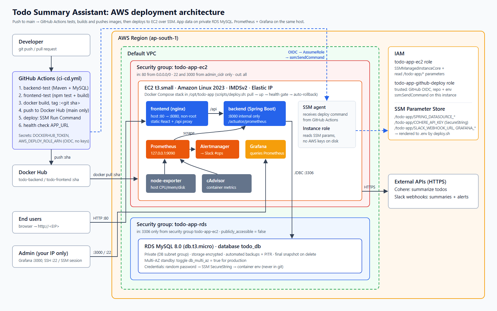

# AWS setup: EC2 + RDS



(Source: [`architecture-diagram.svg`](architecture-diagram.svg).) Everything below is created by the Terraform in [`iac/terraform`](iac/terraform). A console walkthrough is at the end, in case Terraform isn't an option.

## Resources

| Resource | Setting | Why |
|---|---|---|
| EC2 `todo-app-host` | t3.small, Amazon Linux 2023, 20 GiB gp3 (encrypted), IMDSv2 only, Elastic IP | 2 GiB of RAM fits the JVM plus the monitoring stack. The Elastic IP keeps `APP_URL` stable across stop/start. |
| RDS `todo-app-db` | MySQL 8.0, db.t3.micro, 20 GiB gp3, encrypted, **not publicly accessible**, automated backups, final snapshot on delete | Matches the app's MySQL dialect. Free-tier sized. |
| SSM Parameter Store `/todo-app/*` | DB URL/user (String), DB password, Grafana password, Cohere key, Slack webhooks (SecureString) | Single source of runtime config. Nothing secret lives in git or in CI. |
| IAM role `todo-app-ec2` | `AmazonSSMManagedInstanceCore` + read-only on `parameter/todo-app*` | The instance gets temporary credentials from its role, so no AWS keys are stored on disk. |
| IAM role `todo-app-github-deploy` | Trusted only by GitHub OIDC for `repo:<owner>/<repo>:environment:production`. Allowed: `ssm:SendCommand` on **this instance** with `AWS-RunShellScript`, and reading command results. | CI deploys with short-lived credentials. No access keys are kept in GitHub. |
| Docker Hub | `<user>/todo-backend`, `<user>/todo-frontend`, tagged with the commit SHA | Public images contain no secrets, so the host pulls them without registry credentials. |

## Networking and security groups

Kept small on purpose: the default VPC. A production setup would use a dedicated VPC with RDS in private subnets that have no route to an internet gateway.

**`todo-app-ec2`** (attached to the instance)

| Direction | Port | Source | Purpose |
|---|---|---|---|
| in | 80/tcp | 0.0.0.0/0 | Web app (nginx). `/api/*` is proxied to the backend. |
| in | 22/tcp | `admin_cidr` (your IP/32) | Break-glass SSH. Day-to-day access uses SSM Session Manager. |
| in | 3000/tcp | `admin_cidr` | Grafana |
| out | all | 0.0.0.0/0 | Image pulls, SSM endpoints, Cohere/Slack APIs, RDS |

The backend's port 8080 and `/actuator` are **not published** on the host. They are reachable only on the Docker network, and nginx proxies only `/api/`. Prometheus (9090) and Alertmanager (9093) bind to `127.0.0.1`. To reach them, port-forward:

```bash
aws ssm start-session --target <instance-id> \
  --document-name AWS-StartPortForwardingSession --parameters portNumber=9090,localPortNumber=9090
```

**`todo-app-rds`** (attached to the DB)

| Direction | Port | Source |
|---|---|---|
| in | 3306/tcp | security group `todo-app-ec2` only (an SG reference, not a CIDR) |

Together with `publicly_accessible = false`, this means the database cannot be reached from the internet, even with valid credentials.

## IAM: least privilege

- **Instance role.** SSM agent permissions, plus `ssm:GetParameter(s)/GetParametersByPath` on `arn:aws:ssm:<region>:<acct>:parameter/todo-app*`. Decryption uses the AWS-managed `aws/ssm` key, whose key policy already allows in-account use through SSM. It cannot write parameters or touch any other AWS service.
- **Deploy role.** It can run one stock document on one instance and read the output. It cannot create resources, read secrets or touch RDS. The trust policy pins the repository *and* the `production` GitHub environment, so a PR from a fork, or any other workflow job, can't assume it.
- **Humans.** Use an IAM user or SSO with MFA to run Terraform. Never use root keys.

## How configuration reaches the container

```
SSM /todo-app/* ──(instance role)──> scripts/deploy.sh ──> /opt/todo-app/.env (0600, root) ──> docker compose env ──> Spring ${...} placeholders
```

`deploy.sh` regenerates `.env` on every deploy. To rotate a secret, change the parameter and redeploy, or run `deploy.sh <current-sha>`.

## Provisioning step by step

Prerequisites: an AWS account, AWS CLI v2 and Terraform ≥ 1.6 on your machine, a Docker Hub account and access token, and the repo pushed to GitHub (public, so the instance can `git clone` it).

```bash
cd aws/iac/terraform
cp terraform.tfvars.example terraform.tfvars      # fill in your IP, repo, Docker Hub user
terraform init
terraform apply                                   # ~10 min (RDS is the slow part)
```

Set the third-party secrets. Terraform creates them as `CHANGE_ME` placeholders and never overwrites them:

```bash
aws ssm put-parameter --overwrite --type SecureString --name /todo-app/COHERE_API_KEY          --value '<cohere key>'
aws ssm put-parameter --overwrite --type SecureString --name /todo-app/SLACK_WEBHOOK_URL       --value 'https://hooks.slack.com/services/...'
aws ssm put-parameter --overwrite --type SecureString --name /todo-app/ALERT_SLACK_WEBHOOK_URL --value 'https://hooks.slack.com/services/...'
```

Wire up GitHub. In **Settings → Environments**, create an environment called `production` (you can add required reviewers here if you want a manual gate). Then add:

| Where | Kind | Name | Value |
|---|---|---|---|
| Repository | Secret | `DOCKERHUB_TOKEN` | Docker Hub access token (Read & Write) |
| Environment `production` | Secret | `AWS_DEPLOY_ROLE_ARN` | `terraform output github_deploy_role_arn` |
| Repository | Variable | `DOCKERHUB_USERNAME` | your Docker Hub user |
| Repository | Variable | `AWS_REGION` | e.g. `ap-south-1` |
| Repository | Variable | `EC2_INSTANCE_ID` | `terraform output ec2_instance_id` |
| Repository | Variable | `APP_URL` | `terraform output app_url` |

Push to `main` and the pipeline does the first deployment. Grafana is at `terraform output grafana_url` (user `admin`, password from `aws ssm get-parameter --with-decryption --name /todo-app/GRAFANA_ADMIN_PASSWORD`).

**Clean up after the review:** `terraform destroy`. It takes a final RDS snapshot; delete it in the console if you don't need it.

## Console-only alternative (no Terraform)

1. **Security groups.** Create `todo-app-ec2` and `todo-app-rds` with the rules in the tables above.
2. **RDS.** Create a MySQL 8.0 Free-tier DB: DB name `todo_db`, user `todoapp`, *Public access: No*, SG `todo-app-rds`.
3. **SSM parameters.** Create every parameter listed in `.env.example` under `/todo-app/`. Use SecureString for the secrets, and set `SPRING_DATASOURCE_URL=jdbc:mysql://<rds-endpoint>:3306/todo_db` and `IMAGE_REPO=<dockerhub user>`.
4. **EC2 role.** Create a role for EC2 with `AmazonSSMManagedInstanceCore` and an inline policy that allows `ssm:GetParametersByPath` on `parameter/todo-app*`.
5. **EC2.** Launch Amazon Linux 2023 (t3.small) with that role, SG `todo-app-ec2` and IMDSv2 required. Paste [`iac/terraform/user_data.sh.tftpl`](iac/terraform/user_data.sh.tftpl) as user data, replacing `${repo_url}` with your repo URL. Attach an Elastic IP.
6. **GitHub OIDC.** In IAM → Identity providers, add `token.actions.githubusercontent.com` (audience `sts.amazonaws.com`). Create the deploy role with the trust and permission policies shown in `main.tf`.
